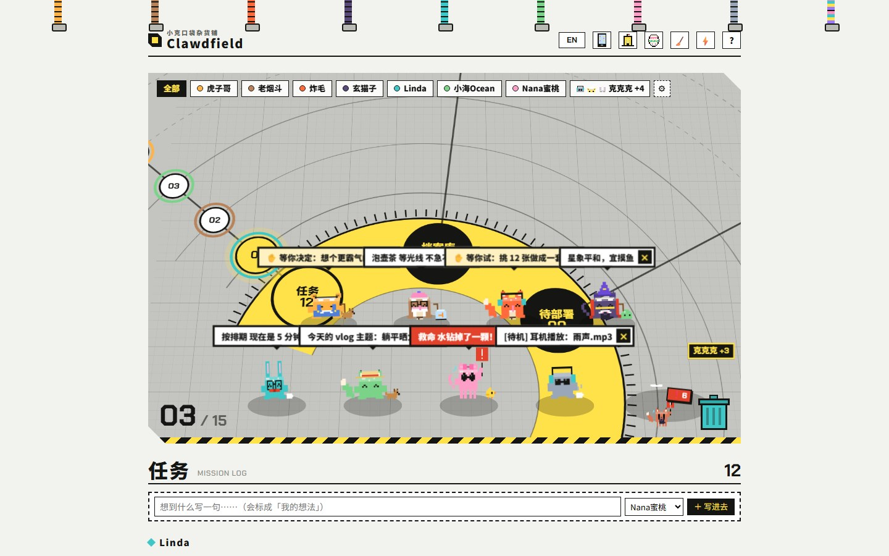

# Clawdfield

**A workbench where every AI project is a pixel creature.** Each project you run with an AI coding agent (Claude Code, Codex…) becomes a little "Clawd" with its own personality, badge and desk; to-dos, saved results and later-ideas hang under its name. Creatures get tired when a project stalls, gossip with each other, and ask you for things. Open it in a browser; your AI fills it in through a tiny command-line tool.

One of three dashboards in my AI workflow: [Clawnveyor](https://github.com/Miaomiaomeowmeow/clawnveyor) (the inspiration pipeline as a warehouse) → [Clawork](https://github.com/Miaomiaomeowmeow/clawork) (skills × projects) → **Clawdfield** (project status).

> **The author is looking for a job!** If you have an opportunity, reach out on [LinkedIn](https://www.linkedin.com/in/miaomiao-yang-331901383) · Xiaohongshu (RedNote) @羊猫猫不是猫

## Set it up

Tell your AI assistant: *"Set this up for me following AI-SETUP.md."* It asks you a few yes / no questions and does the rest. Rules the AI follows afterwards are in `AI-RULES.md`.

Or just double-click `start.bat` (Mac: `start.command`). It opens with 11 sample Clawds so you can see how it works; run `python clawd.py fresh` to start clean (`python clawd.py fresh --sample` brings them back).

Manual: `python clawd.py` (see `python clawd.py -h`), then open `workbench.html`. Optional local server: `python server.py` (lets the page call an AI with your own key or a logged-in Codex / Claude Code).

## Status

Working, still being polished (October 2026). Your data and keys stay in `data/` on your own machine and are never uploaded.

Original work by Miaomiao (GitHub: Miaomiaomeowmeow). CC BY-NC-SA 4.0: remix freely, share what you changed, no commercial use.
